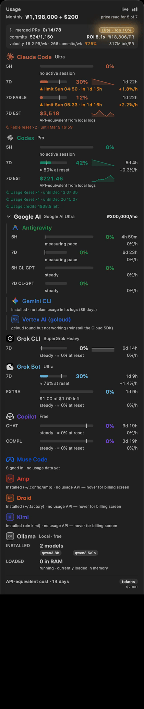
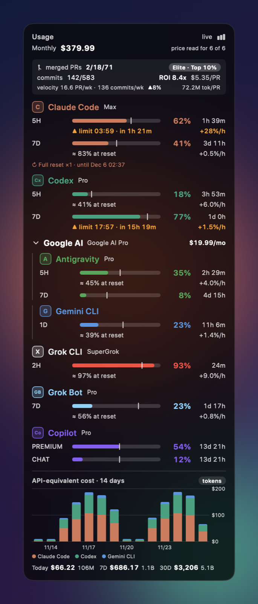
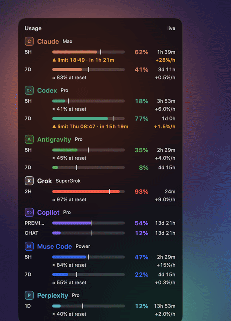
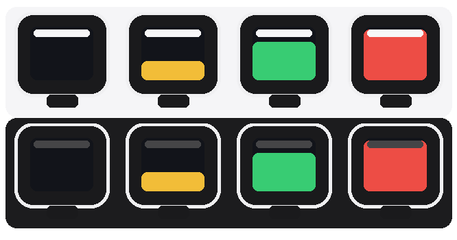

# Phosphor

Mac 메뉴 막대에서 쓰는 AI 코딩 구독 사용량 앱입니다. Claude Code, Codex, Google AI, Grok, Copilot처럼 이미 쓰고 있는 서비스의 한도와 리셋 시각을 한 화면에 모읍니다.

<p align="center">
  <a href="#설치">설치</a> · <a href="#install">Install</a> · <a href="#windows">Windows</a> · <a href="#features">Features</a> · <a href="#privacy">Privacy</a> · <a href="docs/GUIDE.md">Guide</a> · <a href="#한국어">한국어</a>
</p>

## 다운로드

**[최신 릴리스에서 Phosphor.dmg 받기](https://github.com/nirvanasangsara-AI/phosphor-hud/releases/latest)**

macOS 14 이상이 필요합니다. 같은 페이지의 Phosphor.zip은 디스크 이미지를 열 수 없을 때의 대안입니다.

## 설치

1. 받은 DMG를 엽니다.
2. Phosphor를 Applications 폴더로 끌어다 놓습니다.
3. Applications 폴더에서 Phosphor를 실행합니다.

### 처음 열 때

Apple 개발자 서명과 공증을 하지 않은 앱입니다. macOS가 첫 실행을 막을 수 있습니다.

Finder에서 Phosphor를 마우스 오른쪽 단추로 클릭하고 **열기**를 고릅니다. 확인 창이 나오면 **열기**를 다시 누릅니다.

macOS 15 이상에서는 시스템 설정 > 개인정보 보호 및 보안으로 가서 **그래도 열기**를 눌러도 됩니다.

한 번 이렇게 열면 다음부터는 그대로 실행됩니다. 메뉴 맨 위와 사용량 패널 아래의 `Φ · Phosphor · 0.3.4`에서 설치한 버전을 확인할 수 있습니다. 이 브랜치의 `VERSION`은 0.3.4입니다.

---

## Download

**[Get Phosphor.dmg from the latest release](https://github.com/nirvanasangsara-AI/phosphor-hud/releases/latest)**

macOS 14 or later. Phosphor.zip on the same page is a fallback when a disk image does not open.

## Install

1. Open the DMG.
2. Drag Phosphor to the Applications folder.
3. Launch Phosphor from Applications.

### The first time you open it

Phosphor is not signed with an Apple Developer ID and is not notarized, so macOS can block the first launch.

In Finder, right-click Phosphor and choose **Open**. When the dialog appears, click **Open** again.

On macOS 15 and later you can also open System Settings, go to Privacy & Security, and click **Open Anyway**.

After that first launch it opens normally. The top line of the menu and the bottom of the usage panel read `Φ · Phosphor · 0.3.4`. This branch's `VERSION` file is 0.3.4.

---

<p align="center">
  <br>
  <sub>Menu bar indicator. Click it to show or hide the panel.</sub>
</p>

<p align="center">
  
</p>

## Why

You're on Claude Max, ChatGPT Pro, Google AI and a couple more. Each one hides its limits on a different
settings page, with a different reset clock. Phosphor puts all of them in one small floating panel, works
out your burn rate, and tells you **`▲ limit 15:20 · in 1h 21m`** before you hit the wall, not after.

## Features

- **30+ providers, auto-detected.** Claude Code, Codex / ChatGPT, Antigravity, Gemini CLI, Grok CLI, GitHub Copilot,
  Muse Code, Cursor, Windsurf, Cline, Roo Code, Aider, Kiro, Warp, Amp, OpenRouter, Ollama, LM Studio, OpenAI and
  Anthropic API spend, and more. Phosphor finds installed CLIs, apps and logs and turns the right rows on. Toggle any of them.
- **Burn rate and run-out time on every quota bar.** Two recent samples are enough to fit a slope (last hour for 5-hour windows, last 6 hours for weekly ones).
  You get `+3.2%/h` and the time you'll hit 100 % (in the warning colour if that comes before the reset), or `≈ 83% at reset` if you'll make it. When a slope can't be fitted yet the line stays up as `measuring pace`, `steady · 0%/h`, `▲ limit reached`, or `no active session`.
- **Always on top, natively.** A SwiftUI panel with no web runtime that floats over every Space. Compact mode, opacity, click-through, and a `Φ 94%` menu bar item.
- **Fold.** **접기 방식** remembers one of three modes. **고정** stays open. **더블클릭** (the default) folds or opens from the header. **자동 접기** starts as a one-line strip, opens under the pointer, and folds about 0.8s after the pointer leaves. A click on the open strip holds it until the pointer leaves. The pin button in the header does the same as **고정** and returns to the mode you had chosen. The window keeps its top-left corner.
- **Only services you actually use.** **표시할 서비스** is **자동** until you change it. A row appears when this Mac has a login file, a usage log, an API key, or a billing-screen reading. An installed app or an empty config folder (Amp, Droid, JetBrains AI, and the rest of the catalog) stays in the app and stays off the HUD until that evidence shows up. **항상 표시** and **숨김** override that per service.
- **Language.** English by default, with in-app language switching (English, Korean, or follow your macOS system language) covering menus, settings, and burn-rate / depletion descriptions.
- **Subscription ROI.** Local Claude Code / Codex / Gemini CLI logs are priced at API list rates (LiteLLM's public table) and set against what your plans cost: `ROI 8.4x`.
  A 14-day stacked chart shows tokens or dollars per tool.
- **GitHub PR efficiency.** Merged PRs and commits for today / 7D / 30D through your existing `gh` login (read-only), plus cost per PR, tokens per PR and velocity.
  A tier badge places your merged-PRs-per-week within the published [LinearB 2026 benchmark](https://linearb.io/resources/engineering-benchmarks) bands.
  There's no fake global leaderboard.
- **Google AI, grouped.** Antigravity, Gemini CLI, Gemini app, Gemini API, Google AI credits and Vertex AI are separate meters at Google.
  Phosphor shows each one under one collapsible *Google AI* header and counts the subscription once.
- **Drag to reorder.** Grab the grip that appears on hover. The order persists, and *Reset Order* is in the menu.
- **Plans, prices, next bill, reset credits.** Hover a row for its plan card. There's also a monthly total across every plan.
  Stale readings are dimmed, and you get alerts at 70 % / 90 %, on reset, a day before billing, and 3 days before credits expire.
- **Service status dots** from each provider's public status page, **multiple accounts** per provider, and a calendar export of upcoming bills.
- **Themes are JSON.** Clean, Retro CRT, Matrix, Glasses HUD, and *Raid Frames* (quota as HP, with a revive animation on reset).
  You can write your own in a few lines.

<p align="center">
  
  &nbsp;
  
</p>

<sub>These pictures use the built-in demo data (`Phosphor --demo`), not a real account.</sub>

## Windows

The Mac app is SwiftUI. The part worth sharing is PhosphorCore: forecast slopes, alerts, log parsing, and list-price math, with no AppKit in it. The Windows build is a [Tauri 2](https://v2.tauri.app/) shell around a Rust port of that core. Tauri draws the HUD in the system webview, so the download is one small installer instead of a bundled browser, and the numbers stay locked to the Mac tests with golden fixtures.

You get a small always-on-top window you can drag, and a tray icon with Show, Hide, Start at login, and Quit. It reads the same `providers.json`, `accounts.json`, `billing-screens.json`, and `alerts.json` shapes as the Mac build.

### Install

Windows 10 or 11, with the WebView2 runtime (already present on current Windows 11). From a clone:

```bash
cd windows/phosphor-hud
npm install
npm run build
```

`npm run build` reads the repo [`VERSION`](VERSION) file and stamps it on the installer and the window. On this branch the title and the tray menu say `Phosphor 0.3.4`. A new `VERSION` shows up on the next build. The Windows HUD uses the same three fold modes, with the Korean names on the pin and the menu, and keeps the top-left corner when the window height changes.

The NSIS installer is under `windows/phosphor-hud/src-tauri/target/release/bundle/nsis/`. A portable `Phosphor.exe` is next to it in `target/release/`. GitHub Actions on `windows-latest` builds the same thing and uploads it as an artifact. Rust and Node are only needed if you build it yourself.

`npm run tauri dev` runs it unpacked. The core tests alone are `cargo test --manifest-path windows/phosphor-core/Cargo.toml`.

### What works

Live limits when the official CLI has already written a local token file, plus token totals from session logs. The forecast line (`▲ limit …`, `measuring pace`, `steady`, `no active session`) uses the same slope rules as on the Mac. Subscription ROI uses local logs against plan prices in `billing-screens.json`. GitHub PR counts are optional, from the tray, and only through `gh`.

The privacy rules match the Mac app. Phosphor reads local files. When a CLI has already saved a token in its own file, that token is sent only to that provider's usage API and is not stored or printed. The public LiteLLM price table and a public exchange rate are downloaded so ROI can be priced. Browser cookies and Windows Credential Manager are never read.

| Source | Windows path | Confidence |
|---|---|---|
| Claude Code token | `%USERPROFILE%\.claude\.credentials.json` (or `CLAUDE_CONFIG_DIR`) | Official Claude Code docs |
| Claude Code logs | `%USERPROFILE%\.claude\projects` | Inferred from the Mac reader |
| Codex sessions | `%CODEX_HOME%\sessions` if set, else `%USERPROFILE%\.codex\sessions` and `%APPDATA%\codex` | `CODEX_HOME` is official. The two default folders disagree in third-party notes, so both are checked |
| Codex login | `auth.json` in that home | Official only when `cli_auth_credentials_store` is `file`. Windows Credential Manager is not read |
| Gemini CLI logs | `%USERPROFILE%\.gemini\tmp` | Official Gemini CLI layout |
| Grok CLI login | `%USERPROFILE%\.grok\auth.json` | Unverified. Medium confidence, same file the Mac build reads |
| Copilot | `gh.exe auth token` | Official GitHub CLI. The token stays in memory for one request |
| Cline tasks | `%APPDATA%\Code\User\globalStorage\saoudrizwan.claude-dev` | Unverified |
| Roo Code tasks | `%APPDATA%\<host>\User\globalStorage\rooveterinaryinc.roo-cline` | Unverified |
| Phosphor config | `%USERPROFILE%\.config\phosphor` | Same files as macOS |

Antigravity, Muse, and Grok Bot are unknown on Windows. Their rows stay visible and say so, instead of failing or inventing a number.

WSL is not searched. A Windows Phosphor does not read `\\wsl$\` or a Linux home. If the CLIs live in WSL, use them from Linux, or install the Windows CLIs so they write under `%USERPROFILE%`.

### Known limits

This is the first Windows cut. It has not been clicked through on a physical PC in this repo's own check, beyond the Windows CI build.

- Codex and Grok tokens are not refreshed. If the access token is expired, the row says so. Phosphor will not write `auth.json` and will not open Credential Manager.
- Claude Code's refresh token is not used, same as on the Mac. An expired access token with a refresh token still on disk shows "Waiting for token refresh" and keeps local logs.
- Spend for OpenRouter, OpenAI API, and Anthropic API keys is not fetched. If the environment variable is set, the row says the key is present and stops there.
- Themes, Korean UI, menu-bar percent, calendar export, and local git commit counts are still Mac-only.
- Alerts show inside the HUD. There is no Windows toast yet.
- The window is translucent, but WebView2 does not match the Mac material, and some machines draw a thin light edge.

## 0.3.4

The HUD can fold to one line (the title, the highest usage, and the next reset) without leaving its top-left corner.

**접기 방식** is in the menu and is remembered. New installs use **더블클릭**.

- **고정.** The panel stays expanded.
- **더블클릭.** Double-click the header to fold or open it.
- **자동 접기.** The panel starts folded. Hover the strip to open it. Move the pointer away and it folds again after about 0.8 seconds. Click the open strip and it stays open until the pointer leaves.

The pin on the header is filled and labelled **고정** while it is holding the panel open. Click it again to go back to the previous mode.

**표시할 서비스** lists every provider. **자동** is the default. **항상 표시** forces the row on. **숨김** forces it off. Under **자동**, Phosphor looks for a credential file, a usage log, an API key, or a `billing-screens.json` reading. Finding `amp` or `droid` on `PATH`, or a JetBrains IDE in `/Applications`, is not enough.

The Elite chip is back, on the current label. Above 2 merged PRs per week it reads `Elite band · 18.0 PR/wk (benchmark >2.0)` and shimmers gold. Reduce Motion leaves a still glow. That "10%" people saw stuck is LinearB's published ceiling for the Elite band (more than 2.0 merged PRs per developer per week). It is not progress toward a monthly goal. Phosphor does not have a 3,000 PR/month target. Past that ceiling the label shows the real rate, so 3.0 and 18.0 do not look the same.

## 0.3.3

The menu-bar CRT is 18×18 points again. 0.3.2 drew the Retina bitmap in pixels inside that point-sized slot, so only the left half of the monitor showed. 1× is 18×18 pixels and 2× is 36×36 pixels, both sized as 18 points.

## 0.3.2

The menu bar icon is a small CRT. Its screen fills from the bottom with the highest tracked limit. It is drawn in colour, not as a template image, so the bezel stays visible on a light menu bar and on a dark one. The picture below is the same drawing at a few fill levels, on both backgrounds.

<p align="center">
  <br>
  <sub>Empty, under pace (yellow), on pace (green), and burning too fast (red).</sub>
</p>

**Icon colour based on** is in the menu and is remembered.

- **Pace** (the default). The aim is to use about all of a limit in the moment before it resets. Full use is good. Green means the projection at reset is about 85–110%. Yellow means it will finish under 85%, so quota would be left unused. Red means the projection is over 110%, or the burn rate hits the cap before reset. While Phosphor is still measuring a slope, it compares usage with how much of the window has already elapsed. The first 5% of a window stays neutral.
- **Usage.** The colour is only the percent: green under 50%, yellow from 50% through 80%, red above 80%.

The same colour is used on the list gauges for each limit. A window Phosphor cannot pace yet keeps the provider colour.

The panel also has a one-line reset ticker at the top. It rotates one item about every 6 seconds, pauses when the pointer is over it, and opens the source when clicked. Official posts and status incidents come first. Unverified posts are dimmed and tagged **Rumor** / **루머**. **Show reset ticker** and **Include rumors** are on until you turn them off. **Reset feed URL…** takes a Worker address; leave it blank and Phosphor reads the OpenAI, Claude, and xAI status feeds itself.

### Reset feed worker

The Worker lives in [`worker/reset-feed`](worker/reset-feed). It does not ship inside the app. Deploy it yourself when you want posts as well as status incidents.

```bash
cd worker/reset-feed
npm install
npx wrangler kv namespace create RESET_FEED
```

Paste the printed namespace id into `wrangler.toml` in place of `REPLACE_WITH_KV_NAMESPACE_ID`. Then:

```bash
npx wrangler secret put X_BEARER_TOKEN
npx wrangler deploy
```

`X_BEARER_TOKEN` is an X API v2 app-only bearer token. The Worker polls every 15 minutes: original posts from an allowlist (including @thsottiaux, @OpenAIDevs, @ClaudeDevs, @cursor_ai, @SpaceXSI, and @bot), a keyword search for other posts about resets and rate limits, and the three status RSS feeds. It does not follow @grok, @xai, or @OpenAIStatus. `GET /feed.json` serves the cache. Put that URL in **Reset feed URL…**.

You need an X developer app (the bearer token) and a Cloudflare account (Workers and one KV namespace). Nothing here is deployed for you.

## Android

The phone does not read Claude, Codex, or any other app. Turn on **Phone sync** on the Mac or Windows HUD (it is off until you do) and the Android app shows that snapshot in a home-screen widget. Pairing is a QR code on the same Wi-Fi. There is no account. Details and the trade-offs are in [docs/android.md](docs/android.md).

## Privacy

- **No cookie or session scraping, no browser automation, no password prompts.** Phosphor reads only what the official tools already keep for you:
  the CLI's own OAuth token (Claude Code, Codex, Copilot via `gh`), an app's own local usage cache, or a provider's documented API with your key.
- **Never prints or stores tokens.** Credentials stay in the Keychain or the tool's own config. Phosphor only reads them, in memory.
- **Local logs are read for numbers only.** Token counts and model names, never prompts or replies. Everything stays on your Mac,
  in `~/Library/Application Support/Phosphor`.
- **The only network calls** go to the providers' usage endpoints, their public status pages, LiteLLM's public price table,
  a public FX rate (for ROI), GitHub search through your `gh` login, the optional reset-news feed (or the public status RSS feeds when that URL is blank), and provider icons if you choose to download them. No analytics, no telemetry.
- **No guessed numbers.** If a value can't be read, the row says why instead of making one up.

## Documentation

[docs/GUIDE.md](docs/GUIDE.md) covers every provider and how it's read, custom providers, themes, files, notifications,
extra accounts and building. Themes: [docs/THEMES.md](docs/THEMES.md). Releasing: [docs/RELEASE.md](docs/RELEASE.md).

```bash
swift test                    # PhosphorCore unit tests
./scripts/hero.sh             # regenerate README images from demo data
./scripts/screenshots.sh      # theme screenshots + GIF
```

## 개발자

소스에서 빌드하려면 macOS 14 이상과 Xcode Command Line Tools가 필요합니다.

```bash
git clone https://github.com/nirvanasangsara-AI/phosphor-hud.git
cd phosphor-hud
./scripts/build-app.sh --run
```

로그인 없이 화면만 보려면 `dist/Phosphor.app/Contents/MacOS/Phosphor --demo`를 실행합니다. 이 데모에는 실제 계정 데이터가 없습니다.

버전은 저장소 루트의 [`VERSION`](VERSION) 파일 하나입니다. 로컬 빌드와 CI가 같은 파일을 읽고, 메뉴와 사용량 패널에는 `Phosphor 0.3.4`처럼 표시됩니다. 빌드 번호(`CFBundleVersion`)는 git 커밋 수라서 커밋마다 올라갑니다. 릴리스할 때는 `VERSION`을 올린 다음, 그 값과 같은 태그(`v0.3.4`)를 푸시합니다. Actions가 DMG와 zip을 그 릴리스에 붙입니다. 자세한 절차는 [docs/RELEASE.md](docs/RELEASE.md)에 있습니다.

## Developers

The commands above build the app locally. `./scripts/build-app.sh` reads [`VERSION`](VERSION) and writes it into the app, so a local build of this branch shows `Phosphor 0.3.4` in the menu and on the usage panel. To publish, bump `VERSION`, merge to `main`, and push a matching tag such as `v0.3.4`. A Homebrew cask template is in [`packaging/homebrew`](packaging/homebrew/phosphor.rb).

## 한국어

**Phosphor**는 맥 화면 위에 항상 떠 있는 AI 구독 사용량 HUD입니다.

- Claude Code, Codex, Google AI(Antigravity·Gemini), Grok, Copilot 등 30개 이상의 서비스를 자동으로 찾아 한도 %와 리셋 시각을 한눈에 보여 줍니다.
- 최근 사용 속도로 **언제 한도에 닿는지**(`▲ limit 15:20 · in 1h 21m`)를 미리 알려 줍니다.
- 기본 언어는 영어이며, 앱에서 영어 / 한국어 / macOS 시스템 언어를 고를 수 있습니다. 메뉴, 설정, 소진율·예상 소진 안내가 선택한 언어로 바뀝니다.
- 로컬 로그를 API 정가로 환산해 **구독 ROI**를 계산하고, `gh` 로그인으로 **GitHub PR·커밋 효율**을 보여 줍니다. 등급 배지는 LinearB 2026 공개 벤치마크 기준입니다.
- 쿠키·세션 스크래핑은 하지 않습니다. 각 공식 도구가 이미 저장해 둔 값만 읽고, 토큰은 출력하거나 저장하지 않습니다.
- Windows용 첫 빌드도 같은 계산을 씁니다. 설치와 아직 안 되는 항목은 위의 Windows 절에 있습니다. 화면 문구는 영어이고, 접기 방식만 한국어 이름(고정, 더블클릭, 자동 접기)을 씁니다.
- **접기 방식**은 고정, 더블클릭(기본값), 자동 접기 세 가지입니다. 헤더의 핀은 고정을 켰다 끄며, 끄면 이전에 고른 방식으로 돌아갑니다. 창의 왼쪽 위는 그대로입니다.
- **표시할 서비스**의 기본값은 자동입니다. 로그인 파일, 사용 로그, API 키, 결제 화면 기록이 있을 때만 행이 나옵니다. 설치만 된 Amp, Droid, JetBrains AI 등은 코드에는 남아 있고, 증거가 생기면 다시 나타납니다. 서비스마다 항상 표시와 숨김을 고를 수 있습니다.

## License

MIT. Not affiliated with Anthropic, OpenAI, Google, xAI, GitHub, LinearB or any provider listed.

---

*For my beloved wife, daughter, and son. ♥*  
*사랑하는 아내와 딸, 아들에게 바칩니다. ♥*
