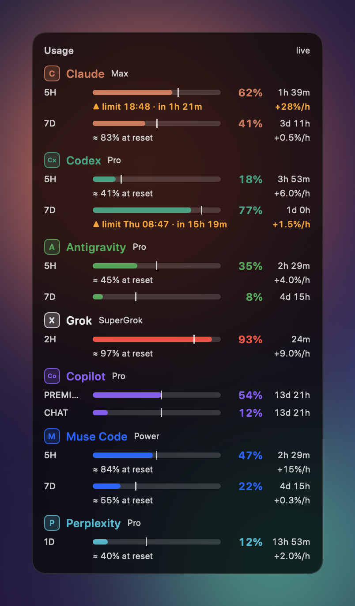
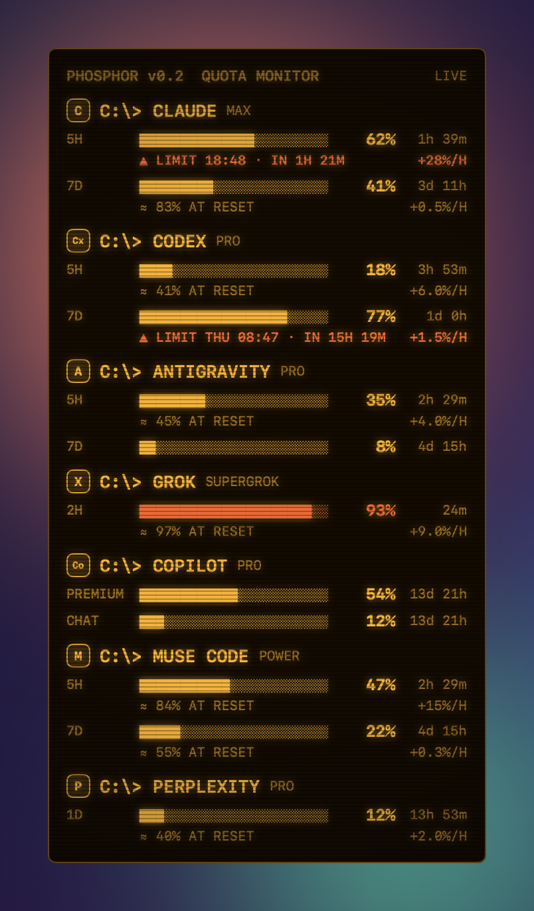
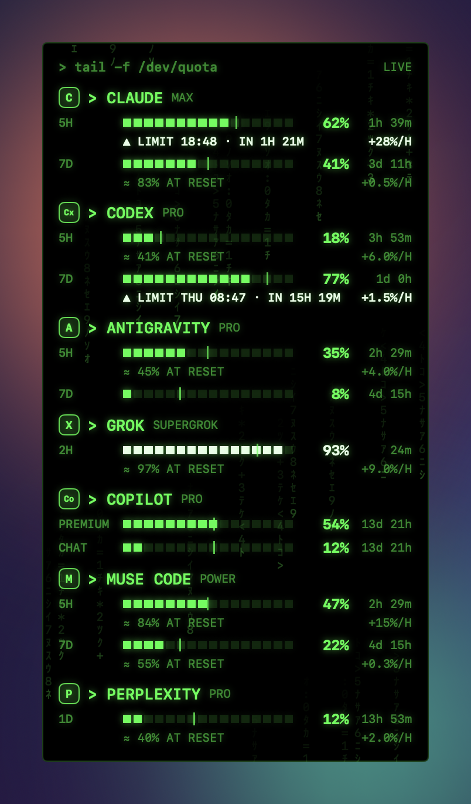
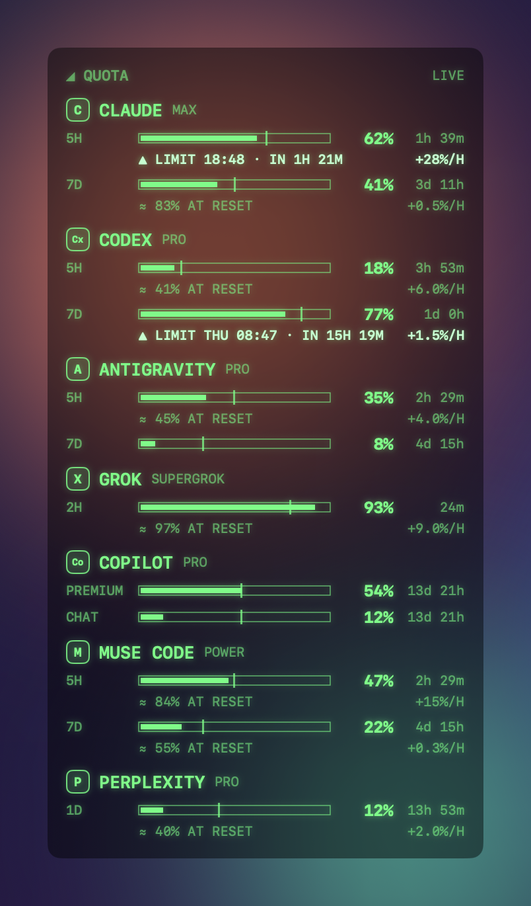
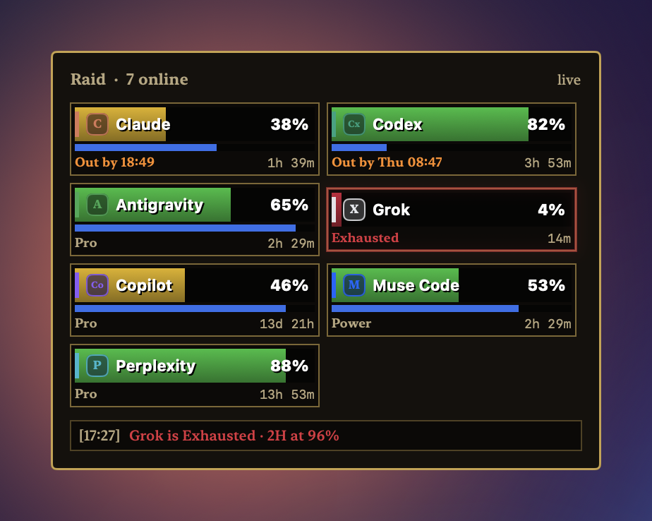

# Phosphor guide

The full reference: themes, every provider and how it's read, files, and building. Back to the [README](../README.md).

## Themes

| Clean | Retro CRT · Amber | Matrix |
|---|---|---|
|  |  |  |
| **Glasses HUD · Green Mono** | **Raid Frames** | |
|  |  | |

Right-click the HUD (or click `Φ` in the menu bar) → **Theme**. To make your own, copy a built-in with
`Phosphor --export-themes ~/.config/phosphor/themes/built-in`, or write a few lines that `"extends"` one.
See [docs/THEMES.md](THEMES.md) and [examples/themes/synthwave.json](../examples/themes/synthwave.json).

## Providers

| Source | How | Needs |
|---|---|---|
| Claude Code | `api.anthropic.com/api/oauth/usage` | Logged in to Claude Code (`claude`) |
| Codex / ChatGPT | `chatgpt.com/backend-api/wham/usage` | Logged in to Codex CLI with ChatGPT |
| Antigravity (Google) | `agy -p /usage --output-format json` (no model turn) | Antigravity CLI 1.1.11+, signed in (`agy`) |
| Grok CLI | Grok CLI billing (`cli-chat-proxy.grok.com`) | Logged in to Grok CLI (`grok login`) |
| Grok Bot | The Grok Bot desktop app's own cached plan reading (`~/Library/Application Support/Grok Bot/sand-client-persistence`, the `weekly-usage.cache` entry). Read-only, no network request; never touches the app's cookies or secrets | Grok Bot app installed and opened recently (numbers are as fresh as the app's last refresh) |
| GitHub Copilot | `api.github.com/copilot_internal/user` | Logged in to the GitHub CLI (`gh auth login`) |
| Muse Code (Meta) | `muse usage --json` (the CLI reports its own allowance) | Muse CLI 1.4.13+, logged in (`muse login`). Without a plan Muse reports no numbers, so the row says *Signed in · no usage data yet* |
| Anything else | Your own script | `~/.config/phosphor/providers.json` |

Every provider shows up automatically once you're signed in to its official CLI. There's nothing to configure.
Not signed in yet, or the login expired? Press **Connect** on that row (or **Providers → Connect …**).
Phosphor opens a Terminal window that runs the service's own sign-in (`claude auth login`, `codex login`,
`agy`, `grok login`, `gh auth login --web`, `muse login`), installing the CLI first if it's missing, and the row
connects within seconds of you finishing in the browser. When the CLI exits, Phosphor reads the usage
with the new login to confirm, and shows why if it didn't work. Pressing Connect again while a sign-in is
open brings that window back instead of opening another. Phosphor never sees your password or the OAuth code.
Phosphor reads tokens the official CLIs already store (`~/.claude/.credentials.json` or the
`Claude Code-credentials` Keychain item, `~/.codex/auth.json`,
`~/.grok/auth.json`, `gh auth token`; Antigravity and Muse are asked via their own `agy … /usage` and `muse usage --json`).
For Codex and Grok, when the access token is close to expiry, Phosphor refreshes it through that CLI's official
OAuth endpoint and writes the updated tokens back to the same `auth.json` (unknown fields are kept; a concurrent
CLI refresh is not overwritten). It never uploads tokens, and it sends each access token only to that provider's own API.

Claude Code's access token only lasts a few hours, and Claude Code renews it itself, but only while it
runs. Phosphor does not use Claude's refresh token and never writes that Keychain item, so it won't rotate
Claude Code's login behind its back. When the stored token has passed its expiry and a refresh token is still
there, the row shows "토큰 갱신 대기 · 로컬 로그 유지" / "Waiting for token refresh · local logs active" and
keeps today's / 7-day tokens from Claude Code's own logs. Live limits come back the next time Claude Code
refreshes the item. **Connect** only appears when there really is no usable login (no refresh token, or a 401
that persists after re-reading the Keychain).

Not every service has a % limit, so a row can show three kinds of reading:

| Kind | Shows | Example |
|---|---|---|
| quota | % of a limit, reset countdown, forecast | `5H ▬▬▬░░ 62%  1h 40m` |
| balance | what's left; a bar too when the total is known | `BAL ▬▬▬░ 75%` · `1234 of 5000 credits left`, or `$4.20 left` |
| meter | usage over a period, no limit | `7D 820K tokens` |

⚠️ These usage endpoints are undocumented and may change or break without notice.

### Plan, price, next bill and credits

Hover a row for its plan, monthly price, next bill and any reset or refill credits (Codex's free
reset with its expiry, Grok Bot's extra credit, Copilot premium requests…). The header sums the
monthly prices Phosphor actually read (`Monthly $200 · price read for 2 of 7`). Nothing is typed in
or guessed: a value a service doesn't report says *Couldn't read* and why.

Values a service only shows on its own settings/billing screen can be saved to
`~/.config/phosphor/billing-screens.json` (by whoever reads that screen) with a `checkedAt` time and
the screen's `source`; they fill only what the API couldn't (or the fields listed in `override`, e.g. a plan name the local cache has out of date), marked `*` with the last-checked time.
`Phosphor --account <id>` prints what Phosphor reads for one provider.

### Custom providers

`~/.config/phosphor/providers.json`:

```json
[{ "id": "team-gateway", "name": "Team Gateway", "color": "#20B8CD",
   "command": "~/.config/phosphor/scripts/manual.sh team-gateway" }]
```

The command prints:

```json
{ "plan": "Pro", "windows": [ { "label": "1D", "used": 42, "windowSeconds": 86400,
                                "resetsAt": "2026-11-25T00:00:00Z" } ] }
```

A window can also be a balance, `{ "kind": "balance", "label": "BAL", "left": 1234, "total": 5000, "unit": "credits" }`
(leave out `total` if you don't know it; `"unit": "USD"` prints dollars), or a meter,
`{ "kind": "meter", "label": "7D", "used": 820000, "unit": "tokens", "windowSeconds": 604800 }`.

See `examples/` for a manual tracker you can feed from Shortcuts. Use this for anything Phosphor doesn't read
natively yet (and open an issue, since native readers get added by demand).

### Icons

No third-party logos ship with Phosphor, for trademark reasons. On first launch Phosphor asks whether to
**download each service's official icon from its own website** (claude.com, chatgpt.com, gemini.google.com,
cursor.com, grok.com, perplexity.ai, …) into `~/.config/phosphor/icons/`. Say no and providers get coloured
monogram badges. You can change your mind under **Providers → Download Official Logos / Remove Downloaded Logos**, or run
`Phosphor --fetch-logos`.

You can also drop your own PNG at `~/.config/phosphor/icons/<id>.png` (e.g. `claude.png`). Phosphor never
overwrites or removes files it didn't download. Mono themes tint icons to the theme colour.

### More providers (catalog of 30)

Beyond the native readers, Phosphor knows 30 providers in total and turns each one on when it finds it
installed (a command on PATH, an app bundle or its config folder), so the HUD stays clean. Toggle any of them
under **Providers → More Providers**; `Phosphor --detect` lists what this Mac has.

| Kind | Providers | What the row shows |
|---|---|---|
| Local session logs | Gemini CLI, Cline, Roo Code (+ Claude Code / Codex for history) | Today / 7-day tokens, API-equivalent estimate |
| Local servers | Ollama, LM Studio | Models installed / loaded (free) |
| API key you give Phosphor | OpenRouter (`OPENROUTER_API_KEY`), OpenAI API (`OPENAI_ADMIN_KEY`, org costs), Anthropic API (`ANTHROPIC_ADMIN_KEY`, cost report), Gemini API / AI Studio (`GEMINI_API_KEY`, key check only) | Balance / month-to-date spend |
| Installed, no usage API | Cursor, Windsurf, Kiro, Warp, JetBrains AI, Zed, Amp, Kimi Code, Droid, OpenCode, Aider, Vertex AI (gcloud) | "Installed", plus plan/price/bill from `billing-screens.json` |
| Web only | Gemini app (web), Google AI credits (Flow/Whisk/Veo) | Plan/quotas read from their screens into `billing-screens.json` |

Keys come from the environment variable or from Phosphor's own Keychain item
(`security add-generic-password -s "Phosphor: openrouter" -a default -w`); they are sent only to their own
service and never shown. Apps opened from Finder don't see shell variables, so the Keychain item is easier.
The OpenAI / Anthropic admin cost readers follow the public API docs but haven't been tried with a live key yet.

**Google AI is several separate meters.** Antigravity (`agy /usage`) ≠ Gemini app on gemini.google.com
(chat, Deep Research, image and Veo quotas) ≠ Gemini CLI ≠ Gemini API / AI Studio ≠ Google One AI credits
(Flow/Whisk/Veo) ≠ Vertex AI. Generating images on gemini.google.com never moves Antigravity's bars. Only
Antigravity and Gemini CLI (logs) can be read automatically; the web app and AI credits have no API, the
Gemini API has no usage endpoint for keys (spend is on aistudio.google.com/usage), and Vertex spend needs a
Cloud Billing BigQuery export.

### Usage history and cost

Phosphor reads Claude Code, Codex, Gemini CLI, Cline and Roo Code session logs **read-only** (usage numbers
only, never prompts or replies), incrementally by byte offset, with resumed-session duplicates removed. The
first scan only reaches back 7 days and runs at background priority; history then grows day by day. Tokens
are priced at API list rates from LiteLLM's public price table (cached for a day); models without a list price
are counted but left unpriced. The chart button in the header (or **Usage chart** in the menu) shows 14 days
stacked by tool, with Today / 7D / 30D totals. Subscriptions don't bill this way: it's what the same use would
cost on the API. `Phosphor --scan-logs` prints the totals.

### Notifications

Warning at 70 %, critical at 90 % (once per window cycle), a window reset (when it had passed 50 %), a bill due
in 1 day and a reset credit expiring within 3 days. Toggle each under **Notifications**; thresholds live in
`~/.config/phosphor/alerts.json`. Bill alerts are never sent from a stale billing-screen date.

### Stale billing screens

A `billing-screens.json` entry whose `nextBill` has passed, or whose `checkedAt` is more than 30 days old, is
dimmed with ⚠︎ on the row, in the hover card and in the menu (*Billing screens need refresh*).

### Service status

Rows get a yellow/red dot when the provider's public status page reports trouble (status.claude.com,
status.openai.com, githubstatus.com, status.x.ai, status.windsurf.com, Google Cloud incidents), checked every
5 minutes. Hover for the incident.

### Extra accounts

`~/.config/phosphor/accounts.json` adds rows such as `codex@work` or `claude@side`:

```json
{ "profiles": [
  { "provider": "codex",  "name": "work", "home": "~/.codex-work" },
  { "provider": "claude", "name": "side", "configDir": "~/.claude-side" } ] }
```

Each points at a login the official CLI already made (`CODEX_HOME=~/.codex-work codex login`,
`CLAUDE_CONFIG_DIR=~/.claude-side claude`).

### GitHub PRs & efficiency

Menu → **GitHub PRs & efficiency** (off by default) adds a strip under the header:

- **Merged PRs** today / 7D / 30D and **GitHub commits** 7D / 30D, from `gh api search/...` with your existing `gh` login (read-only; Phosphor never reads the token). Commits in local repos under `~/Projects`, `~/Developer`, `~/code`, `~/src` (by your git email) are listed separately in the hover card. Refreshed every 30 minutes (15 search calls, under GitHub's 30/min limit).
- **Subscription ROI** = API-equivalent value from local logs ÷ monthly subscriptions prorated to the same days (7D until the log ledger reaches 30 days). Currencies are converted with open.er-api.com, cached daily.
- **Cost per PR** (monthly spend ÷ 30D merged PRs), **tokens per PR**, and **velocity** (PRs/week, commits/week, this week vs the 3 before).
- **Tier badge** placed within the [LinearB 2026 Software Engineering Benchmarks](https://linearb.io/resources/engineering-benchmarks) merge-frequency bands (Elite > 2.0 merged PRs/dev/week = top 10%, Good 1.2–2.0 = top 30%, Fair 0.66–1.2 = top 60%). There's no live leaderboard; above Elite it says "Top 10%" and nothing finer, since the report gives no finer split.
- **Save Monthly Receipt** writes a PNG card to `~/Library/Application Support/Phosphor/receipts/` and copies it (and its text) to the clipboard.

Burn rate (`+X.X%/h`) and the run-out time show on every quota bar. Two samples a few minutes apart are enough to fit a slope (5-hour windows still look at the last hour, weekly ones the last 6 hours). If a slope can't be fitted yet the row stays visible as `measuring pace · 0%/h`, `steady · ≈ X% at reset`, `▲ limit reached`, or `no active session` (when a 5-hour window isn't running). A cached Claude Code reading keeps a forecast line too.

### Calendar export

After each account refresh Phosphor writes `~/.config/phosphor/events-export.json`: upcoming bill dates and
reset-credit expiries (`kind`, `provider`, `title`, ISO `date`, `amount`, `source`, `checkedAt`, `stale`), for
calendar apps such as 일정.

## Files

| Path | What |
|---|---|
| `~/.config/phosphor/providers.json` | Custom providers |
| `~/.config/phosphor/themes/*.json` | Your themes |
| `~/.config/phosphor/icons/<id>.png` | Provider icons (downloaded on request, or your own) |
| `~/Library/Application Support/Phosphor/history.jsonl` | Usage samples for the forecast (trimmed to 30 days once it passes 4 MB) |
| `~/Library/Application Support/Phosphor/usage-ledger.json` | Daily token totals from local logs, and scan offsets |
| `~/Library/Caches/Phosphor/litellm-prices.json` | Public API price table (refreshed daily) |
| `~/.config/phosphor/billing-screens.json` | Values read from services' own billing screens |
| `~/.config/phosphor/alerts.json` | Notification switches and thresholds |
| `~/.config/phosphor/accounts.json` | Extra accounts per provider |
| `~/.config/phosphor/events-export.json` | Upcoming bills and credit expiries (written by Phosphor) |

## Build & develop

```bash
./scripts/build-app.sh            # dist/Phosphor.app (version from the VERSION file)
./scripts/build-app.sh --run      # build and launch
UNIVERSAL=1 ./scripts/build-app.sh  # arm64 + x86_64 (needs full Xcode)
./scripts/screenshots.sh          # regenerate docs/screenshots from --demo
swift test                        # PhosphorCore unit tests (Swift Testing)
./scripts/release.sh              # DMG + zip from VERSION (see docs/RELEASE.md)
```

The app is split into `PhosphorCore` (Foundation-only logic: catalog, log parsing, pricing, alerts, status,
export; unit-tested) and the `Phosphor` app target (SwiftUI/AppKit). A Homebrew cask template is in
`../packaging/homebrew/phosphor.rb`.

Prebuilt builds are on GitHub Releases as `Phosphor.dmg` (and `Phosphor.zip` if a disk image will not open). They aren't notarized yet, so the first launch needs a right-click → **Open**, or System Settings → Privacy & Security → **Open Anyway** on macOS 15+.

